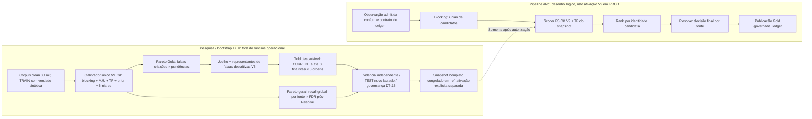

# Mapa de decisões arquiteturais vigentes — Identidade, Linkage V9 e Gold

**Corte documental:** 24/10/2026, `master` em `8b53c84513d2475a45980bd9bde12063438c81d6` (após a PR #1181).  
**Natureza:** índice de reconciliação e estado de evidências, **não nova decisão**, certificação, ato de promoção ou release. Para fatos posteriores, conferir HEAD, PRs e GitHub Actions; um status desta página não se atualiza automaticamente. Não modifica artefatos institucionais publicados.

## 1. Hierarquia e como interpretar o acervo

1. A última release efetivamente selada e a especificação publicada permanecem as indicadas em `RELEASE_INFO.txt` e `Documentos/README.md`. A especificação `Documentos/Especificacao_Tecnica_Jornada_v5.00_Candidata.md` **não** é release aprovada.
2. Requisitos institucionais aplicáveis e decisões canônicas supervenientes orientam o desenvolvimento candidato; alterações de código/CI **não** revogam decisões por si. Para identidade, CPF e vínculo, consultar [decisões canônicas](Decisoes_Canonicas_Identidade_Linkage_20260929.md), a emenda [DC-LK-V9 de 12/10](Decisoes_Canonicas_Identidade_Linkage_20260929.md#dc-lk-v9--decisão-superveniente-v9-nominal-composta-como-única-arquitetura-alvo-12102026) e a [decisão do Calibrador único de 14/10](Decisao_Calibrador_Unico_Adaptativo_Bootstrap_20261014.md).
3. Para bootstrap/Gold, prevalece a decisão de [20/10 com complemento V6 de 24/10](V9_Registro_Decisoes_Bootstrap_Gold_20261020.md). O [índice de decisões](Indice_Decisoes_Vigentes.md) é a porta de entrada; especificações/relatórios V1, V5 e propostas antigas são **fotografias datadas** quando contradizem regras supervenientes.
4. Em cada tema distinguir **DECIDIDO** (regra aprovada), **IMPLEMENTADO** (código integrado no SHA), **MEDIDO** (ensaio realizado no mesmo SHA/ambiente), **VALIDADO** (evidência independente aprovada) e **ATIVADO** (publicação governada). Esses estados não são intercambiáveis.

## 2. Matriz de decisões e evidências

| ID de rastreio | Decisão vigente e justificativa | Fonte detalhada | Estado no corte de 24/10 |
| --- | --- | --- | --- |
| ARQ-ID-01 | `initial_uuid` identifica proveniência de origem, `canonical_uuid` identifica estado corrente; âncora CPF é permanente; divisão/fusão governada, sem sobrevivente artificial; fato válido não se perde com identidade pendente. | [DC-ID-01/02](Decisoes_Canonicas_Identidade_Linkage_20260929.md), [invariantes](Invariantes_Arquitetura.md), [ledger](Identity_Decision_Ledger.md) | DECIDIDO; conferir contratos e gates para cada mudança concreta. |
| ARQ-LK-01 | **V9 nominal composta é a única arquitetura-alvo de novo desenvolvimento**. V8/V6/V7 persistem apenas onde necessários à reprodução/compatibilidade histórica; não abrir segundo scorer operacional. Nome integral e componentes de pessoa/mãe exigem modelagem conjunta/mutuamente exclusiva para evitar dupla contagem. Splink externo é conferência opcional, nunca motor operacional. | [DC-LK-V9/TF](Decisoes_Canonicas_Identidade_Linkage_20260929.md), [transição](Linkage_V9_Composite_Nominal_Transition_20261012.md), [FS](Calibrador_FS_Specification.md) | DECIDIDO; execução V9 operacional e promoção **não certificadas**. |
| ARQ-LK-02 | Um único **Calibrador V9 C#** descobre no bootstrap `m/u`, TF, passes, normalização, limiares, margem, prior e abstenção; números encontrados não se tornam constantes definitivas. Snapshot integral versionado/congelado em `ref`; subida da aplicação **carrega/verifica**, sem treinar. Recalibração posterior apenas por comando manual e aprovação. | [calibrador único](Decisao_Calibrador_Unico_Adaptativo_Bootstrap_20261014.md), [seleção interna](V9_Selecao_Interna_TRAIN_Finalistas_20261019.md), [congelamento](V9_Congelamento_Local_TEST_Independente.md) | DECIDIDO, implementação e operacionalização ainda sujeitas à [issue #1089](https://github.com/lucianox777/Jornada/issues/1089) e gates. |
| ARQ-LK-03 | `LLR=ln(m/u)`, fator de Bayes **1** produz contribuição zero; `w_TF=0` desliga **somente TF**, `w_TF=1` a aplica integralmente; peso parcial é possível. Atributo legitimamente ausente, contribuição neutra por contrato e **parâmetro obrigatório desconhecido** são estados distintos; nunca substituir silenciosamente falta de parâmetro obrigatório por zero. | [DC-LK-TF](Decisoes_Canonicas_Identidade_Linkage_20260929.md), [snapshot V9](V9_Integracao_Local_20261019.md) | DECIDIDO; não atribuir pesos invariáveis aos atributos. |
| ARQ-LK-04 | Campos da Pessoa **não são universalmente obrigatórios** (nome civil, mãe, nascimento, CPF). Quem exige campos é o contrato versionado do Gestor/Base/remessa. Blocking só recupera candidatos; não decide identidade, não assume que homônimo exato é pessoa única e não converte busca truncada/erro em `SEM_CANDIDATO`. Resolver por identidade candidata, publicar decisão final por observação-fonte. | [DC-LK-V9/entradas parciais](Decisoes_Canonicas_Identidade_Linkage_20260929.md), [fluxos/contratos](Fluxos_Blocking_Selecao_Registro.md), [seletor pós-Resolve](V9_Seletor_Pos_Resolve_20261019.md) | DECIDIDO; a evidência física sintética não autoriza ativação de um scorer V9. |
| ARQ-BOOT-01 | Bootstrap DEV usa **30.000 identidades sintéticas clean** (seed 42 e referências IBGE com proveniência). São suficientes para **começar**, não para atestar suporte universal nas 81 células nem eficácia municipal. `correlated` é referência histórica, não segundo perfil automático. Núcleos de suporte por classe, fallback conjunto/marginal e ESS exigem auditoria explícita: suavização não cria observações. | [juízo 30k](Parecer_Suficiencia_Bootstrap_30mil_V9_20261012.md), [DC-LK-30K](Decisoes_Canonicas_Identidade_Linkage_20260929.md), [suporte V3](V9_Suporte_Massa_Backoff_20261019.md) | DECIDIDO; suficiência estatística por célula/estrato e TEST independente não certificadas. |
| ARQ-SEL-01 | Buscar configurações comparáveis no TRAIN, observar **recall global por fonte × FDR pós-Resolve** do bootstrap geral; escolher/recomendar pela evidência com limites e incerteza, sem substituir o seletor por regras estáticas. A seleção interna atual se desdobra em TRAIN_ADJUST e TRAIN_SELECTION; não reutilizar VALIDATION/TEST consumidos como holdout novo. | [seleção TRAIN](V9_Selecao_Interna_TRAIN_Finalistas_20261019.md), [Pareto geral](V9_Bootstrap_Equilibrio_Congelamento_Unificado_20261017.md), [TEST independente](V9_Congelamento_Local_TEST_Independente.md) | DECIDIDO; selecionar, congelar, validar e ativar são gates separados. |
| ARQ-GOLD-01 | O **limiar inferior de não-vínculo** é descoberto, não pré-fixado. No **Pareto Gold 2D** minimizar **falsas criações × pendências** em TRAIN; **não** confundir com o Pareto geral de recall × FDR. Sem orçamento prévio arbitrário de duplicatas (10%, 2% etc.); faixas **descritivas** 0,5%, 1%, 2%, 5%, 100% não são teto operacional. Preservar joelho normalizado e até três finalistas distintos escolhidos pelos representantes de faixas não vazias, sem inventar candidatos. | [registro 20/10 + V6](V9_Registro_Decisoes_Bootstrap_Gold_20261020.md), [orquestração](Gold_Orquestracao_Matriz_12_LocalDB_TRAIN_20261021.md), [CLI](V9_LowerTrain_Gold_Physical_CLI_20261022.md) | **IMPLEMENTADO:** seletor Gold V6 na `master` pela [PR #1181](https://github.com/lucianox777/Jornada/pull/1181), merge `8b53c845`. **NÃO medido fisicamente na matriz V6**. |
| ARQ-GOLD-02 | A prévia estática de TRAIN **não simula cascata**. Medir controle CURRENT e políticas sugeridas em **três ordens físicas** (baseline, reversa, intercalada), cada corrida com LocalDB novo e mesmo corpus/fit: `3 × (1+k)`, `0≤k≤3`. Relatar pendências, falsas criações físicas, falsos vínculos/pares Gold, B-cubed com cobertura, FDR, fragmentação e variação entre ordens. Não escolher pela melhor ordem. | [Gold três ordens](Gold_Tres_Ordens_TRAIN_20261020.md), [matriz](Gold_Orquestracao_Matriz_12_LocalDB_TRAIN_20261021.md), [issue #1180](https://github.com/lucianox777/Jornada/issues/1180) | **MEDIDO PARCIALMENTE em V5**, não V6: run [#40124876599](https://github.com/lucianox777/Jornada/actions/runs/40124876599) concluiu estudo Pareto estático e três CURRENT, mas **falhou no primeiro KNEE**; matriz física experimental não existe. |
| ARQ-GOLD-03 | Patch experimental do guard DT-10 somente em banco **novo, isolado e comprovadamente LocalDB**. Segurança fail-closed: validar nome exato da procedure, ocorrência única do guard, `THROW 51810`, inexistência de motivo experimental; SQL Server 17 normaliza `CREATE OR ALTER` para `CREATE PROCEDURE`, portanto compilação do módulo já instalado usa `ALTER PROCEDURE`. No preflight físico, compilar patch **dentro de transação**, `ROLLBACK` e exigir `OBJECT_DEFINITION` idêntico antes/depois: **CURRENT não pode ser contaminado**. | [diagnóstico #1180](https://github.com/lucianox777/Jornada/issues/1180), [PR #1182](https://github.com/lucianox777/Jornada/pull/1182), [PR #1183](https://github.com/lucianox777/Jornada/pull/1183) | **EM PR, não integrado neste corte**: #1182 corrige cabeçalho/guard; #1183 adiciona preflight, Windows LocalDB [#40141616684](https://github.com/lucianox777/Jornada/actions/runs/40141616684) **SUCCESS** no HEAD `885f5e9`. Sucesso pontual ≠ CI completa ou matriz V6. |
| ARQ-GOV-01 | `TRAIN → seleção/congelamento → avaliação independente nova → TEST lacrado → DT-15` sem realimentar TEST. O modelo ativo, DT-15, `ref`, Gold operacional, IBGE original, JornadaLocal, NODE/NAS, HML/PROD não são alterados por ensaio científico. DT-23 observa suficiência read-only; não recalibra/promove por conta própria. | [congelamento e TEST](V9_Congelamento_Local_TEST_Independente.md), [DT-15](DT15_Governanca_Decisao_Modelo.md), [DT-23](DT23_Diagnostico_Automatico_Suficiencia_FS.md), [invariantes](Invariantes_Arquitetura.md) | DECIDIDO; **V9/DT-15 não ativados** pela série de ensaios Gold. |

## 3. Evidência física e limitações no corte

- A massa clean seed42 foi reproduzida em 30.000 pessoas / 58.148 observações; `observacoes.csv` SHA-256 `28bbb9f4c63c97c353e7f29cdbc77091a4773b2f4c596e46103edadd93635d17`. No estudo TRAIN_SELECTION houve **5.003 grupos independentes**, **3.369 fontes já representadas** e **2.825 pendências estáticas**.
- **Prévia V5 (estática):** limiar 0,05 → 2.792 criações propostas, 3 hipóteses de falsa criação, 33 pendências. A dedução `[0,05;0,5;0,7]` ao aplicar V6 **à tabela V5** não é saída de execução física V6.
- **CURRENT físico V5 nas três ordens:** pendências 2.788 / 2.856 / 2.761; falsas criações físicas 1 / 2 / 1; falsos pares Gold 3 / 0 / 6; F1 B-cubed com cobertura 0,697587 / 0,690381 / 0,700641. Esses valores pertencem somente ao mesmo TRAIN sintético. Nenhuma política experimental foi concluída.
- **Causa da parada:** `OBJECT_DEFINITION` do SQL Server 17 normalizou o cabeçalho DT-10. A sonda [#40132062400](https://github.com/lucianox777/Jornada/actions/runs/40132062400) isolou a causa. O run V5 [#40124876599](https://github.com/lucianox777/Jornada/actions/runs/40124876599) foi **completed/failure** e preserva o artifact parcial `#12574495860`, **sem** `gold-12-trial-matrix.json`. A correção SQL17 e o preflight estão nas PRs #1182/#1183, que exigem merge com gates.
- **Antes de novo run V6:** confirmar integrações e hashes, preflight Windows verde no SHA relevante, pré-registro na issue #1180 da mesma grade `0.001,0.005,0.01,0.02,0.05,0.1,0.2,0.3,0.5,0.7,0.8`, suportes mínimos `1000` grupos e `100` fontes representadas e zero acesso a TEST. A matriz compara CURRENT mais até três **finalistas efetivamente selecionados na V6**, não valores impostos por expectativa.

## 4. Regra editorial para evitar falsas conclusões

- **V8** aparece como destino em trechos datados de setembro; **DC-LK-V9 de 12/10** superou esse destino para novo desenvolvimento. Não apagar proveniência ou reescrever retrospectivamente.
- **VALIDATION** aparece como estágio de seleção em estudos antigos; para os runs recentes, a seleção exploratória está particionada dentro de TRAIN; VALIDATION histórica já consumida **não** é holdout novo. Avaliação independente posterior exige novo corpus/protocolo autorizado.
- A [nota V1 do limiar](V9_Limiar_Inferior_NaoVinculo_TRAIN_20261020.md) registra tetos revogados; não transformá-los em gate. A saída **V5** é evidência histórica imutável e não deve ser renomeada para **V6**.
- **Aprovação de CI** não constitui publicação do bundle ativo, suficiência estatística, autorização DT-15 ou teste em população municipal.

## 5. Diagramas e rastreabilidade

Os diagramas em [UML_Arquitetura_Indice.md](UML_Arquitetura_Indice.md) e [Invariantes_Arquitetura.md](Invariantes_Arquitetura.md) são vistas de revisão com baselines próprias; **não devem ser lidos como diagrama V9+Gold V6 integral e atualizado**. O fluxo normativo, para esta frente, deve ser lido nos contratos citados acima: ingestão → blocking versionado (recuperação) → FS C# V9 + TF do snapshot → Rank por identidade → Resolve por fonte → proposta de vínculo/não-vínculo → publicação Gold governada, com trilha versionada. A seleção e os ensaios do calibrador são **offline**, não um controlador que altera pesos dinamicamente na ingestão.

### Fluxo lógico de revisão — **alvo V9 não ativado**

A seta pontilhada **não indica implantação realizada**. A prévia do limiar inferior usa a decisão existente do Rank/Resolve; a mudança experimental na procedure DT-10 fica restrita à infraestrutura isolada e não entra neste fluxo operacional sem nova autorização e migration canônica.

Regeneração de UML/DER e DOCX/PDF institucionais exige etapa editorial e gate de publicação próprios; **não substituir arquivos selados** por uma figura ou estado experimental.

**Verificação operacional obrigatória:** ao integrar qualquer mudança na frente, comparar este mapa com HEAD, `Solution/docs/Indice_Decisoes_Vigentes.md`, `Estado_Atual_Projeto.md`, evidências da issue #1180 e workflows do SHA antes de atualizar os rótulos IMPLEMENTADO/MEDIDO/VALIDADO/ATIVADO.
